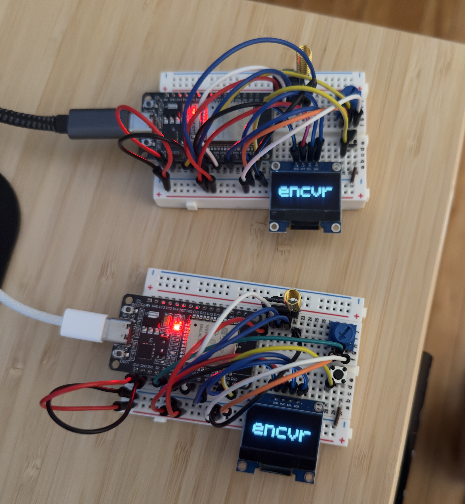

# encvr
Encrypted Transciver for ESP32

## Pin Layout
| ESP32 | Connects to | Signal |
| --- | --- | --- |
| 16 | RYLR998 | ESP32 RX, to radio TXD |
| 17 | RYLR998 | ESP32 TX, to radio RXD |
| 18 | RYLR998 | Reset |
| 3V3 | RYLR998 | Power |
| GND | RYLR998 | Ground |
| 21 | SSD1306 OLED | SDA |
| 22 | SSD1306 OLED | SCL |
| 3V3 | SSD1306 OLED | Power |
| GND | SSD1306 OLED | Ground |
| 23 | Button | Input |
| GND | Button | Ground |
| 4 | Potentiometer | Wiper (ADC2) |
| 3V3 | Potentiometer | Power |
| GND | Potentiometer | Ground |

## Technologies
- C
- ESP-IDF
- FreeRTOS
- ESP32 (ESP-WROOM-32)
- RYLR998 LoRa module
- SSD1306 128x64 OLED (I2C)
- LVGL 8 with esp_lvgl_port
